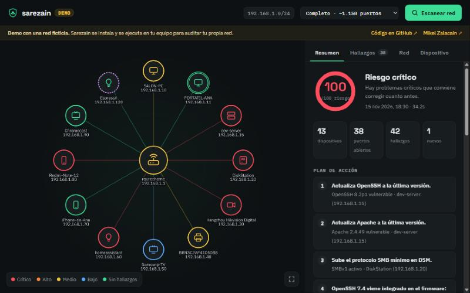
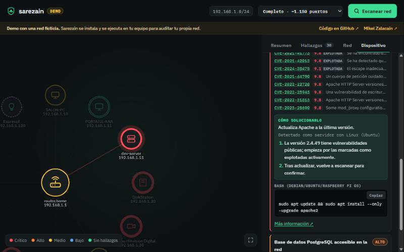
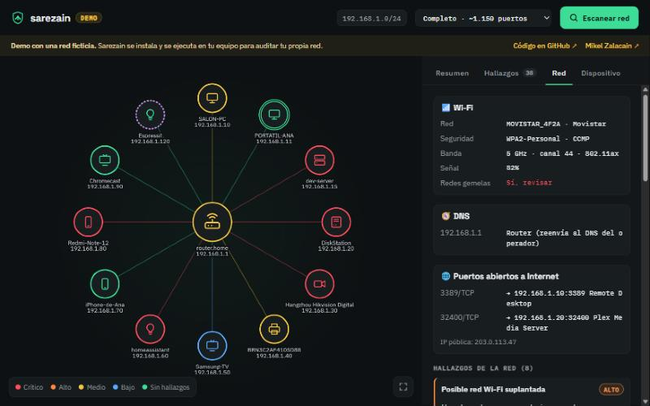

# Sarezain

**Escáner visual de vulnerabilidades para tu red local.** Descubre los dispositivos conectados, analiza sus puertos y servicios, cruza las versiones con la base de datos de vulnerabilidades del NIST y te dice **cómo arreglar cada problema en ese aparato concreto**.

*Sarezain* viene del euskera: *sare* (red) + *zain* (guardián).

**[▶ Probar la demo online](https://sarezain.mikelzalacain.com)** — con una red ficticia, sin instalar nada.



## Qué analiza

### Dispositivos
- **Descubrimiento** por ping, sondas TCP (para equipos que ignoran el ping), tabla ARP y UPnP/SSDP.
- **Identificación**: fabricante por MAC (registro oficial del IEEE, 40.000+ fabricantes), modelo por UPnP, nombres por mDNS/Bonjour y NetBIOS, y sistema operativo estimado por TTL y servicios.
- **~1.150 puertos TCP** por equipo (perfil completo) o 60 (perfil rápido), con segunda pasada para no perder puertos importantes.
- **Sondas de servicio** que leen producto y versión: HTTP/HTTPS, SSH, FTP, SMB, MySQL, Redis, VNC, Docker, Elasticsearch…

### Comprobaciones de seguridad
| Categoría | Ejemplos |
|---|---|
| Protocolos inseguros | Telnet, FTP (y FTP anónimo), SMBv1, VNC, formularios de acceso por HTTP |
| Servicios expuestos | Escritorio remoto, WinRM, ADB de Android, bases de datos, API de Docker |
| Sin autenticación | Redis, Elasticsearch, SNMP con comunidad `public` |
| TLS | Certificados caducados o autofirmados, TLS 1.0/1.1, cifrados sin *forward secrecy* |
| IoT | Cámaras RTSP, MQTT sin cifrar, TR-069, UPnP |
| **CVE** | Vulnerabilidades conocidas por producto y versión (NVD del NIST), marcando las **explotadas activamente** según la CISA |

### La red
- Seguridad del Wi-Fi (abierta, WEP, WPA/TKIP, WPA2, WPA3) y **nombre de fábrica del operador**.
- **Redes gemelas** sospechosas (mismo nombre, distinta seguridad).
- **Puertos que el router abre a Internet** mediante UPnP-IGD.
- DNS en uso, indicios de **suplantación ARP** e IPv6 público.

### Tu equipo (Windows, sin permisos de administrador)
Firewall, Microsoft Defender, actualizaciones, versión de Windows, BitLocker, SMBv1 y firma SMB, Escritorio remoto, UAC, cuenta de invitado y programas escuchando en la red.

## Soluciones personalizadas

Cada hallazgo incluye un plan adaptado al dispositivo: no es lo mismo SMBv1 en tu PC que en un NAS Synology o en una TV.



- **Este equipo** → comandos de PowerShell listos para copiar.
- **Otro Windows / Linux** → ruta de menús, comandos o líneas de configuración (`smb.conf`, `sshd_config`, `redis.conf`…).
- **NAS Synology / QNAP** → ruta exacta en DSM / QTS.
- **Router del operador** → panel del router y aviso si la opción suele estar bloqueada por el operador.
- **TV, cámaras, impresoras, IoT** → firmware, opciones del aparato y aislamiento en la red de invitados.

El resumen ordena todo en un **plan de acción** priorizado.



## Instalación

Requiere **Python 3.10+**.

```bash
git clone https://github.com/mikelzalacain/sarezain.git
cd sarezain
python -m venv .venv
.venv\Scripts\activate          # Windows  (Linux/macOS: source .venv/bin/activate)
pip install -e .
```

## Uso

```bash
sarezain                 # abre el panel en http://127.0.0.1:8765
sarezain scan            # escaneo desde la terminal
sarezain scan --json     # resultado en JSON
sarezain scan --profile rapido --no-cve
```

Opcional: con una [clave gratuita de la NVD](https://nvd.nist.gov/developers/request-an-api-key) en la variable `SAREZAIN_NVD_KEY` la consulta de CVE es más rápida.

## Seguridad y ética

- **Úsalo solo en redes propias o con autorización expresa.** Escanear redes ajenas puede ser ilegal.
- Solo escanea **redes privadas** (10/8, 172.16/12, 192.168/16) y de como máximo **/22**: rechaza cualquier IP pública.
- **No explota vulnerabilidades ni prueba contraseñas.** Las únicas comprobaciones "de acceso" son las que no requieren credenciales: FTP anónimo, Redis sin contraseña y SNMP con la comunidad pública `public` (solo lectura).
- El panel escucha únicamente en `127.0.0.1`.
- **Privacidad**: a la NVD solo se envía producto y versión (p. ej. `OpenSSH 8.9p1`), nunca IPs ni datos de tu red. Los resultados se guardan en `~/.sarezain/`.

## Arquitectura

```
sarezain/
  discovery.py    ping, TCP, ARP, SSDP
  identify.py     mDNS, NetBIOS, UPnP, SNMP, sistema operativo
  ports.py        escaneo TCP asíncrono (asyncio)
  probes.py       sondas de servicio y TLS
  cve.py          NVD del NIST con caché
  netaudit.py     Wi-Fi, DNS, UPnP-IGD, ARP, IPv6
  hostaudit.py    auditoría del equipo local (PowerShell)
  checks.py       reglas → hallazgos con gravedad
  remediation.py  soluciones adaptadas a cada dispositivo
  scanner.py      orquestación por fases
  server.py       API local (FastAPI)
  web/            panel (HTML/CSS/JS + Cytoscape.js)
tools/
  update_oui.py   actualiza la base de fabricantes del IEEE
  make_demo.py    genera la red ficticia de la demo con el motor real
  build_demo.py   construye la demo estática
```

**Stack:** Python 3 (asyncio, sockets, sin dependencias de escaneo externas como nmap), FastAPI, Uvicorn, Cytoscape.js.

## Autor

**Mikel Zalacain González** · Técnico DAM y ASIR · [mikelzalacain.com](https://mikelzalacain.com) · [LinkedIn](https://www.linkedin.com/in/mikelzalacain/)

Licencia MIT.
